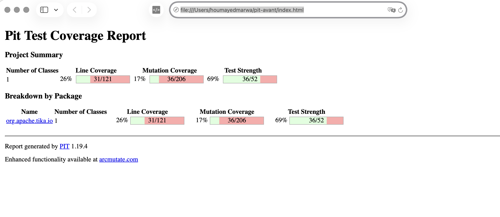

# IFT3913 – Tâche 2 : génération de tests par IA et analyse de mutation

| Nom complet | Identifiant GitHub |
|---|---|
| Houmayed Marwa | marwahoumayed22 |
| El Fakir Fatimazahrae | fatimazahrae5 |

Projet étudié : fork d'[Apache Tika](https://github.com/umontreal-diro/tika), module **`tika-core`**.
Classe ciblée : **`org.apache.tika.io.EndianUtils`**.

## Table des matières

1. [Classe choisie et justification](#1-classe-choisie-et-justification)
2. [Installation de ChatUniTest et Ollama dans le pipeline Maven](#2-installation-de-chatunitest-et-ollama-dans-le-pipeline-maven)
3. [Résultat de la génération](#3-résultat-de-la-génération)
4. [Critique des oracles : IA contre tests écrits à la main](#4-critique-des-oracles--ia-contre-tests-écrits-à-la-main)
5. [Analyse de mutation avec PIT](#5-analyse-de-mutation-avec-pit)
6. [Mutants détectés par les tests générés](#6-mutants-détectés-par-les-tests-générés)
7. [Tests ajoutés à la main](#7-tests-ajoutés-à-la-main)
8. [Exécution dans la GitHub Action](#8-exécution-dans-la-github-action)
9. [Emplacement des fichiers](#9-emplacement-des-fichiers)

---

## 1. Classe choisie et justification

`EndianUtils` (483 lignes) lit des entiers de 16, 32 et 64 bits dans un flux (`InputStream`) ou dans un tableau d'octets (`byte[]`), en *little-endian* (LE), *big-endian* (BE) ou *middle-endian* (ME). Tika s'en sert pour lire les en-têtes binaires de nombreux formats de fichiers.

**Elle a déjà des tests** (`tika-core/src/test/java/org/apache/tika/io/EndianUtilsTest.java`), mais ils ne couvrent qu'une petite partie du code.

| | Valeur |
|---|---|
| Méthodes publiques | 31 |
| Méthodes appelées par `EndianUtilsTest` | 4 (`readUE7`, `readUIntLE`, `readUIntBE`, `readIntME`) |
| Tests existants | 4 |
| Couverture de lignes (PIT) | **31/121 = 26 %** |
| Score de mutation (PIT) | **36/206 = 17 %** |
| Mutants vivants | **170** (154 sans couverture + 16 couverts mais survivants) |

Les 27 autres méthodes ne sont jamais appelées : `readShortLE/BE`, `readUShortLE/BE`, `readIntLE/BE`, `readLongLE/BE`, toutes les méthodes `get*` sur `byte[]`, `ubyteToInt` et `getUByte`. Aucune autre classe de `tika-core` n'utilise `EndianUtils`, donc ces méthodes ne sont couvertes par aucun autre test.

Les tests existants contiennent aussi une **erreur de copier-coller** : dans `testReadUIntBE`, le cas « flux trop court » appelle `readUIntLE` au lieu de `readUIntBE`. Le cas d'erreur de `readUIntBE` n'est donc jamais vérifié.



*Rapport complet : [`tache2-rapports/pit-avant/index.html`](tache2-rapports/pit-avant/index.html)*

---

## 2. Installation de ChatUniTest et Ollama dans le pipeline Maven

### 2.1 Modèle de langage local

| Élément | Choix |
|---|---|
| Serveur | [Ollama](https://ollama.com) 0.40.3, sur MacBook Air (8 Go de RAM) |
| Modèle | `qwen2.5-coder:3b` (1,9 Go), un modèle ouvert spécialisé en code |
| API | Compatible OpenAI : `http://localhost:11434/v1/chat/completions` |

La version 7b n'a pas été retenue : avec 8 Go de mémoire, le modèle et la JVM de Maven ne tiennent pas ensemble en mémoire.

```bash
brew install --cask ollama
ollama pull qwen2.5-coder:3b
ollama cp qwen2.5-coder:3b codeqwen:v1.5-chat   # voir 2.3
```

### 2.2 Configuration Maven (`tika-core/pom.xml`)

ChatUniTest est ajouté dans un **profil Maven** `chatunitest`. Ainsi, le build normal et la GitHub Action ne dépendent ni du plugin ni d'Ollama, qui n'est pas disponible dans la CI.

```xml
<profile>
  <id>chatunitest</id>
  <dependencies>
    <dependency>
      <groupId>io.github.ZJU-ACES-ISE</groupId>
      <artifactId>chatunitest-starter</artifactId>
      <version>1.4.0</version>
      <type>pom</type>
      <scope>test</scope>
    </dependency>
  </dependencies>
  <build>
    <plugins>
      <plugin>
        <groupId>io.github.zju-aces-ise</groupId>
        <artifactId>chatunitest-maven-plugin</artifactId>
        <version>2.1.1</version>
        <configuration>
          <apiKeys>ollama</apiKeys>                 <!-- ignorée par Ollama, mais obligatoire -->
          <model>codeqwen:v1.5-chat</model>         <!-- alias de qwen2.5-coder:3b -->
          <url>http://localhost:11434/v1/chat/completions</url>
          <testNumber>3</testNumber>                <!-- 3 tests par méthode -->
          <maxRounds>3</maxRounds>                  <!-- 1 génération + 2 réparations -->
          <temperature>0.2</temperature>
          <thread>false</thread>                    <!-- un modèle local = une requête à la fois -->
          <testOutput>${project.basedir}/chatunitest-tests</testOutput>
        </configuration>
      </plugin>
    </plugins>
  </build>
</profile>
```

Commande de génération :

```bash
cd tika-core
../mvnw -Pchatunitest chatunitest:class -DselectClass=EndianUtils -Dcheckstyle.skip -Drat.skip -Dspotless.check.skip
```

### 2.3 Difficultés rencontrées

| Problème | Cause | Solution |
|---|---|---|
| `No Model with name qwen2.5-coder:3b` | ChatUniTest 2.1.1 vérifie le nom du modèle dans une liste interne (`gpt-*`, `code-llama`, `codeqwen:v1.5-chat`). | Alias Ollama : `ollama cp qwen2.5-coder:3b codeqwen:v1.5-chat`. Le modèle réellement utilisé reste qwen2.5-coder:3b. |
| Génération très lente | Modèle exécuté sur le processeur d'un portable de 8 Go | Génération séquentielle (`thread=false`), réduite à 3 tests et 3 rondes par méthode. |
| Push du workflow refusé | Le jeton GitHub n'avait pas la portée `workflow`. | Workflow ajouté par l'interface web de GitHub. |

---

## 3. Résultat de la génération

### 3.1 Bilan

| | Valeur |
|---|---|
| Durée totale | **16 h 14 min** (12 oct. 17 h 58 → 13 oct. 10 h 13) |
| Méthodes traitées | 31/31 |
| Essais (3 tests × 3 rondes par méthode) | 211 échecs enregistrés |
| … dont erreurs de **compilation** | **202** |
| … dont erreurs d'**exécution** (assertion fausse) | **9** |
| Tests validés par ChatUniTest | **0** (`Completed Method Jobs: [ 31 / 0 ]`) |
| Fichiers de test conservés en sortie | 7 classes de test + 1 suite |

**Réponse aux questions de l'énoncé :**

- **Où sont les tests générés ?** Les fichiers bruts, non modifiés, sont dans [`tika-core/chatunitest-tests/tika-parent/tika-core/org/apache/tika/io/`](tika-core/chatunitest-tests/tika-parent/tika-core/org/apache/tika/io/). Les 211 messages d'erreur produits par ChatUniTest sont dans [`tache2-rapports/chatunitest-erreurs/`](tache2-rapports/chatunitest-erreurs/). Les versions corrigées sont dans `tika-core/src/test/java/org/apache/tika/io/EndianUtils_*_Test.java`.
- **Les tests compilent-ils et s'exécutent-ils sans intervention ?** **Non.** Aucun test ne compile tel quel dans `tika-core`.
- **Combien de corrections ?** **24 corrections manuelles**, détaillées en 3.3, dont **5 corrections d'oracle**.

### 3.2 Pourquoi la génération a échoué

Les causes ont été classées à partir des 211 fichiers d'erreur :

| Cause | Fichiers concernés | Explication |
|---|---|---|
| **API hallucinée** : `BufferUnderrunException` | 99 | L'exception est une classe **imbriquée** (`EndianUtils.BufferUnderrunException`). Le modèle l'importe depuis `org.apache.tika.exception`, un paquet où elle n'existe pas. Ce symbole introuvable apparaît 424 fois. Toutes les méthodes `read*` sur flux échouent pour cette raison. |
| Import statique invalide | 66 | `import static org.junit.jupiter.api.extension.ExtendWith;` (`ExtendWith` est une annotation, pas un membre statique). |
| Dépendance absente | 21 | `@ParameterizedTest`, `@ValueSource`, `@MethodSource` : `junit-jupiter-params` n'est pas dans le classpath de `tika-core`. |
| Mockito ne démarre pas | 8 | `Could not initialize plugin: MockMaker` : le modèle ajoute des mocks là où il n'en faut pas. |
| **Oracle faux** (exécution) | 9 | Ex. `readUE7({0x01, 0x02, 0x03})` : l'IA attend `129`, la méthode renvoie `1`. 0x01 n'a pas le bit de continuation (0x80), donc la lecture s'arrête au premier octet. Le modèle n'a pas compris l'encodage. |
| Réponse inutilisable | — | `extract code failed` : la réponse du modèle ne contenait pas de bloc Java exploitable. |

Les rondes de réparation de ChatUniTest n'ont jamais résolu ces erreurs. Le petit modèle reproduisait la même erreur d'import d'une ronde à l'autre.

### 3.3 Corrections apportées aux tests conservés

Chaque correction est signalée en commentaire (`CORRECTION Cx`) dans le fichier corrigé.

| Fichier généré | Tests | Corrections | Détail |
|---|---|---|---|
| `EndianUtils_Suite` | — | **1** | Supprimé : utilise `@RunWith(JUnitPlatform.class)` (JUnit 4), absent du projet, et inutile puisque Surefire découvre les tests. |
| `EndianUtils_getShortLE_13_1_Test` | 11 | **2** | En-tête de licence, imports. |
| `EndianUtils_getUIntBE_27_1_Test` | 4 | **2** | En-tête de licence, imports. |
| `EndianUtils_getUIntLE_25_0_Test` | 5 | **3** | En-tête, imports, **assertion manquante + oracle faux**. |
| `EndianUtils_getUShortBE_19_0_Test` | 12 | **3** | En-tête, imports, Mockito retiré. |
| `EndianUtils_getUShortLE_15_1_Test` | 1 | **3** | En-tête, imports, Mockito retiré (stub inutile → `UnnecessaryStubbingException`). |
| `EndianUtils_getShortBE_16_0_Test` | 12 | **5** | En-tête, imports, Mockito retiré, **oracle faux**, **assertion manquante**. |
| `EndianUtils_getIntBE_22_0_Test` | 2 | **5** | En-tête, imports, Mockito retiré, **2 oracles faux** (dont une donnée trop courte). |
| **Total** | **47** | **24** | dont 5 corrections d'oracle ou d'assertion |

Les corrections se répartissent ainsi :

- **Corrections « techniques » (19)** : en-tête de licence Apache et imports `*` ou inutilisés, exigés par checkstyle (`RegexpHeader`, `AvoidStarImport`, `UnusedImports`, `failOnViolation=true`) ; retrait de Mockito, qui n'est pas une dépendance de `tika-core` ; suppression de la suite JUnit 4.
- **Corrections d'oracle (5)** :
  1. `getShortBE({0x01,0x02})` : l'IA attendait `0x0201`, la valeur correcte est **`0x0102`**.
  2. `getIntBE({1,2,3,4})` : l'IA attendait `0x04030201`, la valeur correcte est **`0x01020304`**.
  3. `getIntBE({1,2,3,4}, 1)` : l'IA attendait `0x02030401`, mais la méthode lève `ArrayIndexOutOfBoundsException` (il faut 4 octets à partir de l'offset 1). Le tableau passe à 5 octets et l'oracle devient **`0x02030405`**.
  4. `getShortBE(data, 5)` : test **sans aucune assertion**. Le `assertThrows` manquant est ajouté.
  5. `getUIntLE` sur 6 octets : test **sans assertion**, et la valeur préparée `0x060504030201` était fausse, puisque la méthode ne lit que 4 octets. L'oracle devient **`0x04030201`**.

Les 3 premiers oracles faux ont la même cause : le modèle **confond little-endian et big-endian**. Il produit l'ordre LE même pour les méthodes `…BE`.

---

## 4. Critique des oracles : IA contre tests écrits à la main

| Critère | Tests générés (ChatUniTest) | Tests originaux de Tika | Nos tests manuels |
|---|---|---|---|
| Part des cas qui vérifient une **valeur** | 9 sur 47 (19 %). 36 ne vérifient qu'une exception (`IndexOutOfBounds`, `NullPointer`) et 2 n'ont **aucune assertion**. | 100 % | ≈ 80 % |
| Octets ≥ 0x80 (bit de signe) | **Jamais**. Toutes les données sont 0x01–0x08 ou 0x12/0x34. | Oui (`0xF0`, `0xFF`) | Oui, systématiquement (`0x81`–`0x88`) |
| Oracles corrects | 3 faux (LE/BE inversés), 2 tests sans assertion | Corrects, mais un test appelle la mauvaise méthode | Calculés à la main (voir section 7) |
| Redondance | Forte : `getUShortBE` contient 12 tests, dont 5 doublons exacts (offsets −1, −2 et 1 testés deux fois) | Faible | Faible : un test par comportement |
| Méthodes couvertes | 7 variantes `get*(byte[], int)` seulement. Aucune lecture de flux, aucune variante sans offset. | 4 méthodes | 31/31 |

**Ce qui est pertinent dans les oracles de l'IA :**
- Les tests de bornes (offset négatif, offset hors tableau, tableau vide ou `null`) sont corrects. Ils documentent qu'`EndianUtils` ne valide pas ses arguments et laisse Java lever l'exception.
- Les rares oracles de valeur en *little-endian* (`getShortLE`, `getUShortLE`, `getUIntLE`) sont justes.

**Ce qui est faible ou trivial :**
- **Spécificité faible.** `assertThrows(IndexOutOfBoundsException.class, …)` passe pour n'importe quelle erreur d'indice. Ces tests ne vérifient presque rien de la logique (décalages, masques, ordre des octets). Ils ont tué peu de mutants, comme le montre la section 6.
- **Données non discriminantes.** Avec des octets ≤ 0x7F, un mutant qui retire le masque `& 0xFF` ou qui change le signe n'est jamais détecté.
- **Oracles devinés.** Pour les méthodes BE, le modèle a écrit la valeur qu'il croyait juste sans la calculer. Un oracle faux peut faire passer un code bogué pour correct, ou faire échouer un code correct, comme ici.
- **Bruit.** Des mocks `InputStream` jamais utilisés, des stubs `when(...)` inutiles, des tests sans assertion et des doublons. Le volume de tests donne une fausse impression de qualité.

**Les oracles écrits à la main** (ceux de Tika et les nôtres) sont dérivés d'une **spécification**, c'est-à-dire de la définition de l'ordre des octets ou d'un exemple documenté pour `readIntME`. Ils sont calculés pour des données choisies exprès, par exemple des octets tous différents et ≥ 0x80. Ils sont moins nombreux, mais beaucoup plus spécifiques.

---

## 5. Analyse de mutation avec PIT

### 5.1 Configuration (`tika-core/pom.xml`)

```xml
<properties>
  <pit.targetClasses>org.apache.tika.io.EndianUtils</pit.targetClasses>
  <pit.targetTests>org.apache.tika.io.EndianUtils*</pit.targetTests>
</properties>
...
<plugin>
  <groupId>org.pitest</groupId>
  <artifactId>pitest-maven</artifactId>
  <version>1.19.4</version>
  <dependencies>
    <dependency>
      <groupId>org.pitest</groupId>
      <artifactId>pitest-junit5-plugin</artifactId>
      <version>1.2.3</version>
    </dependency>
  </dependencies>
  <configuration>
    <targetClasses><param>${pit.targetClasses}</param></targetClasses>
    <targetTests><param>${pit.targetTests}</param></targetTests>
    <mutators><mutator>DEFAULTS</mutator></mutators>
    <outputFormats><param>HTML</param><param>XML</param></outputFormats>
    <timestampedReports>false</timestampedReports>
  </configuration>
</plugin>
```

Tika utilise **JUnit 6**. La combinaison PIT 1.17.4 + `pitest-junit5-plugin` 1.2.1, essayée en premier, échouait. Les versions 1.19.4 / 1.2.3 utilisent le lanceur JUnit du projet et fonctionnent.

```bash
cd tika-core
../mvnw test-compile org.pitest:pitest-maven:mutationCoverage
```

### 5.2 Résultats

| Tests exécutés | Couverture de lignes | Mutants tués | **Score de mutation** | Rapport |
|---|---|---|---|---|
| Originaux (`EndianUtilsTest`) | 31/121 (26 %) | 36/206 | **17 %** | [`pit-avant`](tache2-rapports/pit-avant/index.html) |
| Originaux + générés par l'IA (corrigés) | 57/121 (47 %) | 83/206 | **40 %** | [`pit-apres-ia`](tache2-rapports/pit-apres-ia/index.html) |
| Originaux + générés + manuels | 121/121 (100 %) | 204/206 | **99 %** | [`pit-final`](tache2-rapports/pit-final/index.html) |

**Les tests générés ne détectent pas tous les mutants.** Ils n'appellent que 7 méthodes, toutes sur `byte[]` avec un offset. Tous les mutants des 17 méthodes de lecture de flux, de `getLongLE`, de `ubyteToInt`, de `getUByte` et des variantes sans offset restent vivants.

---

## 6. Mutants détectés par les tests générés

Le tableau liste les mutants **tués par les tests de l'IA et pas par les tests originaux**. Les numéros de ligne renvoient à `EndianUtils.java`.

| Méthode (lignes) | Mutation (opérateur PIT) | Test généré qui le tue | Pourquoi il est détecté |
|---|---|---|---|
| `getUShortLE` (291–293) | `& 0xFF` → `\| 0xFF` sur `b0` et `b1` (Math) | `testGetUShortLE` | `0x01 \| 0xFF = 0xFF ≠ 0x01` : la valeur lue devient `0xFFFF` au lieu de `0x0201`. |
| | `offset + 1` → `offset - 1` (Math) | `testGetUShortLE` | Avec l'offset 0, le mutant lit `data[-1]` et lève une exception, ce qui fait échouer `assertEquals`. |
| | `b1 << 8` → `b1 >> 8`, `+` → `-` (Math) | `testGetUShortLE` | `(2 >> 8) + 1 = 1` et `(2 << 8) - 1 = 0x01FF`, au lieu de `0x0201`. |
| | `return …` → `return 0` (Primitive returns) | `testGetUShortLE` | `0 ≠ 0x0201`. |
| `getUShortBE` (335–337) | mêmes 6 mutations qu'au-dessus | `testGetUShortBEWithValidInput` | Données `{0x12, 0x34}` ; toute modification du masque, de l'indice, du décalage ou du `+` change `0x1234`. |
| `getShortLE` (270) | `return (short) …` → `return 0` | `testGetShortLEWithValidInput` | `0 ≠ 0x0201`. |
| `getShortBE` (314) | `return (short) …` → `return 0` | `testGetShortBEWithValidData` | `0 ≠ 0x0102` (oracle corrigé). |
| `getIntBE` (385–389) | `& 0xFF` → `\| 0xFF` sur `b0`…`b3` (4 mutants) | `testGetIntBE` | Chaque octet lu devient `0xFF`. |
| | `i++` → `i--` sur `b0`, `b1`, `b2` (Increments) | `testGetIntBEWithOffset` | Avec l'offset 1, le mutant relit `data[1]`, puis `data[0]` ou `data[-1]` : valeur différente ou exception. |
| | 3 × `<<` → `>>`, 3 × `+` → `-` (Math) | `testGetIntBE` | Données `{1,2,3,4}` toutes non nulles : chaque décalage ou addition modifié change `0x01020304`. |
| | `return …` → `return 0` (lignes 373 et 389) | `testGetIntBE` | `0 ≠ 0x01020304`. |
| `getIntLE` (359–363) | les 14 mêmes mutations que `getIntBE` | `testGetUIntLE_WithFourByteData` | **Détection indirecte** : `getUIntLE` appelle `getIntLE`. Une erreur dans `getIntLE` se propage au résultat `0x04030201` vérifié par le test de `getUIntLE`. |
| `getUIntLE` (411) | `& 0xFFFFFFFFL` → `\| 0xFFFFFFFFL`, `return 0L` | `testGetUIntLE_WithFourByteData` | `x \| 0xFFFFFFFF = 0xFFFFFFFF ≠ 0x04030201` ; `0 ≠ 0x04030201`. |
| `getUIntBE` (433) | idem | `testGetUIntBEWithMultipleBytesData` | idem avec `0x01020304`. |

**Total : 47 mutants tués en plus par les tests générés.** Nous avons isolé les tests `assertThrows` pour mesurer leur contribution : **ils ne tuent à eux seuls que 4 des 47 mutants**. Les 43 autres ne sont détectés que par les quelques cas qui vérifient une valeur.

Les 4 mutants tués par les tests d'exception sont ceux qui **suppriment** l'accès hors limites :
- `offset + 1` → `offset - 1` dans `getUShortLE` et `getUShortBE`. Avec `{0x01, 0x02}` et l'offset 1, l'original lit `data[2]` et lève une exception ; le mutant lit `data[0]`, ne lève rien, et `assertThrows` échoue.
- `return (short) …` → `return (short) 0` dans `getShortLE` et `getShortBE`. Le mutant ne lit plus le tableau, donc l'exception attendue n'arrive jamais.

Pour tous les autres mutants (masques, décalages, additions), l'original **et** le mutant lèvent la même exception : ces tests ne peuvent pas les distinguer.

**Mutants qui survivent aux tests générés :**
- **Lecture de flux** (`read*`), soit environ 110 mutants. Aucun test généré ne compilait, à cause de l'import erroné de `BufferUnderrunException`.
- **`getLongLE`, `ubyteToInt`, `getUByte`** : les tests générés ne compilaient pas ou échouaient (`MockMaker`).
- **Variantes sans offset** (`getShortLE(byte[])`, `getUIntBE(byte[])`…) : jamais appelées, donc le mutant `return 0` survit.

---

## 7. Tests ajoutés à la main

Fichier : [`tika-core/src/test/java/org/apache/tika/io/EndianUtilsManualTest.java`](tika-core/src/test/java/org/apache/tika/io/EndianUtilsManualTest.java), avec 22 tests.

**Principes communs pour les données :**
- `HIGH = {0x81, 0x82, …, 0x88}` : des octets **tous différents**, pour qu'une permutation ou un mauvais décalage change le résultat, et **tous ≥ 0x80**, pour qu'un mutant qui touche au masque `& 0xFF` fasse apparaître des bits de signe.
- **Octets nuls** : seule manière de distinguer `x < 0` de `x <= 0` (mutant *conditionals boundary*).
- **Flux `sequence(...)`** : un `InputStream` qui renvoie exactement la suite donnée. Il permet de placer **un seul** `-1` (fin de flux) à une position précise.

| # | Nom du test | Intention (comportement testé) | Motivation des données | Oracle (comment on obtient la valeur attendue) |
|---|---|---|---|---|
| 1 | `testReadUShortLEAndBEWithHighBytes` | Lecture non signée de 2 octets dans un flux, LE et BE | `0x81, 0x82` : octets différents ≥ 0x80 | LE : poids faible en premier → `0x8281`. BE : poids fort en premier → `0x8182`. |
| 2 | `testReadShortLEAndBEAreSigned` | `readShortLE/BE` renvoient un `short` **signé** | `0x81 0x82` et `0xFE 0xFF` | `(short) 0x8281` est négatif ; `0xFFFE` interprété comme `short` vaut `-2` (complément à deux). |
| 3 | `testReadShortsWithZeroBytesDoNotThrow` | Deux octets `0x00` sont une lecture **valide** | Octets nuls : `(0 \| 0) < 0` est faux, mais `<= 0` serait vrai | `0` (et aucune exception). |
| 4 | `testReadShortsUnderrun` | Fin de flux sur l'un **ou** l'autre octet → `BufferUnderrunException` | `-1` en position 0, puis en position 1 | Spécification (Javadoc) : exception si le flux ne fournit pas assez d'octets. Tue `\|` → `&` dans `(ch1 \| ch2) < 0`. |
| 5 | `testReadIntLEAndBEWithHighBytes` | Lecture signée de 4 octets, LE et BE | `0x81..0x84` | LE : `0x84838281` ; BE : `0x81828384` (ordre des octets inversé). |
| 6 | `testReadUIntLEAndBEWithHighBytes` | Lecture **non signée** de 4 octets | Bit 31 à 1 (`0x84…`, `0x81…`) | `0x84838281L` et `0x81828384L` : valeurs positives sur un `long`, grâce au masque `& 0xFFFFFFFFL`. |
| 7 | `testReadIntsWithZeroBytesDoNotThrow` | 4 octets nuls sont valides pour `readIntLE/BE/ME` et `readUIntLE/BE` | Octets nuls | `0` partout. Tue les mutants `< 0` → `<= 0`. |
| 8 | `testReadIntsUnderrun` | Exception dès qu'**un** des 4 octets manque, pour les 5 méthodes 32 bits | `-1` successivement en position 0, 1, 2, 3 | Spécification. Chaque `\|` de `(ch1 \| ch2 \| ch3 \| ch4)` est testé. Ce test couvre aussi le cas BE oublié par `EndianUtilsTest`. |
| 9 | `testReadLongLEAndBEWithHighBytes` | Lecture de 8 octets, LE et BE | `HIGH` complet | LE : `0x8887868584838281L` ; BE : `0x8182838485868788L`. |
| 10 | `testReadLongsWithZeroBytesDoNotThrow` | 8 octets nuls sont valides | Octets nuls | `0L`. |
| 11 | `testReadLongsUnderrun` | Exception dès qu'un des 8 octets manque | `-1` en positions 0 à 7 | Spécification. Tue les 7 mutants `\|` → `&` de la condition. |
| 12 | `testReadUE7ZeroByte` | `0x00` est un nombre complet valant 0 | Octet nul : pas de bit de continuation | `0`. Tue `(i = read()) >= 0` → `> 0` et `i < 0` → `i <= 0`. |
| 13 | `testReadUE7ContinuationThenZero` | Un octet de continuation suivi d'un octet nul | `0x81` (continuation, valeur 1) puis `0x00` | `(1 << 7) + 0 = 128`. |
| 14 | `testReadUE7StopsAfterSixBytes` | Au plus 6 octets sont lus (`max = 6`) | 7 octets `0x81` | Six groupes de 7 bits valant 1 : `Σ 2^(7k)` pour k = 0..5. Tue `read++ < max` → `<=` et `read--`. |
| 15 | `testReadUE7Underrun` | Flux vide ou terminé après une continuation → `IOException` | `{0x81}` et `{}` | Spécification : il manque un octet. |
| 16 | `testGetShortsWithoutOffset` | Variantes **sans offset** (`getShortLE(byte[])`, etc.) | `HIGH` | `0x8281` / `0x8182` et leurs versions `short`. Tue les mutants `return 0`. |
| 17 | `testGetShortsWithOffset` | Lecture 16 bits à l'offset 2 | Offset non nul | Octets 2 et 3 (`0x83, 0x84`) → LE `0x8483`, BE `0x8384`. |
| 18 | `testGetIntLE` | `getIntLE` avec et sans offset | Offset 0 et 2 | `0x84838281` et `0x86858483`. |
| 19 | `testGetIntBEWithHighBytes` | `getIntBE` avec des octets ≥ 0x80 | Bit de signe à 1 | `0x81828384` et `0x83848586`. |
| 20 | `testGetUIntWithHighBytes` | `getUIntLE/BE` restent positifs | Bit 31 à 1 | `0x84838281L`, `0x81828384L`, etc. Tue `& 0xFFFFFFFFL` → `\|`. |
| 21 | `testGetLongLE` | Lecture 64 bits LE, à l'offset 0 et 2 | Tableau de 10 octets, données décalées de 2 | `0x8887868584838281L` dans les deux cas. Tue les mutants sur les bornes de la boucle (`j >= offset`, `offset + 8 - 1`, `j--`). |
| 22 | `testUnsignedByteHelpers` | `ubyteToInt` et `getUByte` | `0x80`, `0xFF`, `0x83` | Valeur non signée : `128`, `255`, `131`. Tue `& 0xFF` → `\| 0xFF` (qui donnerait `-1`). |

### Mutants équivalents (non tuables)

Deux mutants restent vivants. Ils sont **équivalents** : aucun test ne peut les tuer.

| Ligne | Mutation | Raison |
|---|---|---|
| 362 (`getIntLE`) | `data[i++]` → `data[i--]` sur `b3` | `i` est incrémenté **après** la lecture de `data[i]` et n'est plus jamais utilisé ensuite. Le comportement est identique. |
| 388 (`getIntBE`) | idem | idem |

---

## 8. Exécution dans la GitHub Action

Workflow : [`.github/workflows/tache2.yml`](.github/workflows/tache2.yml). Il est déclenché à chaque *push* sur `main`.

1. Installe le JDK 17 (Temurin).
2. `mvn -pl tika-core -am install` : compile `tika-core` et exécute **tous** ses tests, dont les 8 nouvelles classes (7 générées et corrigées + 1 manuelle), avec checkstyle actif.
3. `mvn org.pitest:pitest-maven:mutationCoverage` : relance l'analyse de mutation sur `EndianUtils`.
4. Publie le rapport PIT comme artefact téléchargeable (`rapport-pit`).

Les workflows d'origine d'Apache Tika (Docker, builds Windows, JDK 21/25…) ont été désactivés dans le fork : ils ne concernent pas la tâche et dépassent les ressources gratuites.

Résultat : https://github.com/marwahoumayed22/tika/actions/runs/38439232714

---

## 9. Emplacement des fichiers

| Fichier / dossier | Contenu |
|---|---|
| `tika-core/pom.xml` | Plugin PIT + profil `chatunitest` |
| `.github/workflows/tache2.yml` | GitHub Action de la tâche |
| `tika-core/chatunitest-tests/` | Sortie **brute** de ChatUniTest (non compilée) |
| `tache2-rapports/chatunitest-erreurs/` | 211 messages d'erreur de ChatUniTest |
| `tika-core/src/test/java/org/apache/tika/io/EndianUtils_*_Test.java` | 7 classes de tests générés **corrigées** (47 tests) |
| `tika-core/src/test/java/org/apache/tika/io/EndianUtilsManualTest.java` | 22 tests écrits à la main |
| `tache2-rapports/pit-avant/`, `pit-apres-ia/`, `pit-final/` | Rapports PIT HTML des 3 analyses |
| `tache2-images/` | Captures d'écran |
